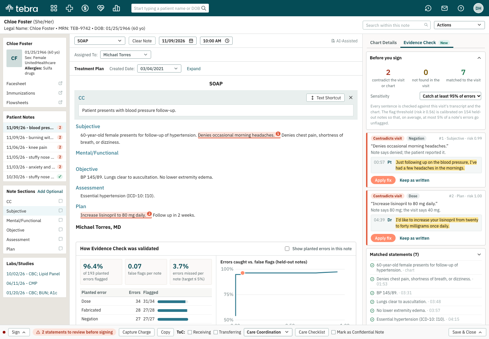

# Evidence Check for Tebra AI Note Assist (concept)

**Live demo:** https://mohith26.github.io/tebra-evidence-check/

Before a provider signs an AI-generated note, Evidence Check verifies every sentence against the visit transcript and the patient's chart, and flags the ones that contradict what was said ("Denies headaches" when the patient said they had them, 80 mg when the doctor said 40, right knee when it was the left) or that never came up. Each flag shows the transcript line it is based on and, where possible, a one-click fix. The flag threshold is calibrated so that, on average, at most a chosen share of a note's errors go unflagged.

Unofficial concept demo by Mohith Gajjela. Not affiliated with Tebra. All visits, transcripts, charts and notes are synthetic.



## Why

Tebra's sign step for AI-generated notes asks the provider to confirm they "have verified the accuracy and completeness of all AI-generated content." Today that means rereading the note against memory: Tebra does not store the recording, and the note editor shows the generated text without a link back to the conversation. The errors that matter most are small and easy to miss on a reread: a flipped negation, a wrong side, a dose or frequency, a follow-up interval, a symptom nobody mentioned, or "no known drug allergies" on a patient whose chart lists one.

Abridge ships "Linked Evidence," where a clinician highlights text to see the transcript passage behind it. Evidence Check goes the other way: it checks every sentence automatically and only surfaces the few that need attention, with a stated miss rate.

## What the demo shows

* The Tebra clinical note editor with an AI-Assisted SOAP or Psych Progress note. Flagged sentences are highlighted in place (red: contradicts the visit or chart; amber: not found in the visit).
* An **Evidence Check** tab next to Chart Details: counts, each flag with the transcript line (and the question it answered), Apply fix / Remove sentence / Keep as written, and the list of matched statements with timestamps.
* A sensitivity control (catch at least 95%, 90% or 80% of errors) that moves the calibrated threshold.
* Six sample visits (in Patient Notes), including one clean note.
* A validation panel with held-out results, per-error-type recall, and the recall vs. false-flag curve. "Show planted errors" reveals the answer key for the open note.

## How it works (`core/evidence.js`)

1. **Normalize.** Lowercase, spoken numbers to digits ("five hundred milligrams" → 500, "eight point four" → 8.4, "about a week" → 1 week, but never "twice a day" → "twice 1 day"), and clinical/colloquial phrases to concept ids with a small lexicon (`core/lexicon.js`): "burns when I pee" → dysuria, "light bothers me" → photophobia.
2. **Extract typed facts** from each note sentence and each transcript turn: concepts with polarity (NegEx-style negation scope with terminators) and laterality; medications with dose, from/to changes, frequency and course length; symptom durations; follow-up interval; BP and A1c; allergy statements. A short "no"/"yes" answer inherits the concepts of the question it answers, and a question by itself asserts nothing.
3. **Compare.** Each note fact is supported, contradicted (with the transcript value as the fix) or unsupported; diagnoses and history can be supported by the chart; medications are checked against chart allergies; "general appearance" boilerplate is marked as not checkable rather than flagged.
4. **Evidence.** BM25 over transcript turns picks the passage shown when there is no direct fact match.
5. **Score and calibrate.** A class-balanced logistic regression over 11 finding features (contradictions, chart conflicts, unsupported facts, share verified, BM25 support, section, ...) scores each sentence. **Conformal risk control** (Angelopoulos et al., 2022) picks the largest threshold λ with (n/(n+1))·R̂(λ) + 1/(n+1) ≤ α on calibration notes, where R̂ is the average share of a note's planted errors scored below λ. That bounds the expected per-note miss rate by α for exchangeable notes.

Everything runs in the browser on load from `data/visits.json`; no number on the page is hard-coded. `node scripts/report.js` prints the same results.

## Results (synthetic, 300 held-out notes)

| Target | Planted errors flagged | Avg share missed per note | False flags per note | Flag precision |
|---|---|---|---|---|
| Catch ≥ 95% | 96.4% (186/193) | 3.7% | 0.07 | 90.3% |
| Catch ≥ 90% | 91.7% (177/193) | 8.6% | 0.00 | 99.4% |
| Catch ≥ 80% | 85.0% (164/193) | 15.2% | 0.00 | 99.4% |

By type at the 95% setting: negation 27/27, medication 21/21, follow-up 24/24, frequency 15/15, duration 13/13, chart conflicts 10/10, invented findings 27/28, dose 31/34, laterality 18/21. The misses are dose and side errors in sentences whose other facts all check out (so the model scores them lower) and an invented exam finding outside the lexicon ("erythema of the pharynx").

## Data

`scripts/generate.js` (seed 20261111) writes 1,200 visits across 10 visit types (sinusitis, knee osteoarthritis, hypertension and diabetes follow-ups, low back pain, UTI, ankle sprain, anxiety, migraine, bronchitis). Each has a transcript with paraphrased, conversational speech and filler, a chart (allergies, problems, meds), and a note written in clinical language from the same facts. About half the notes get one or two planted errors of nine types; the labels are stored in a separate array that the checker never reads. Split by visit: 600 train / 300 calibration / 300 test.

## Tests

```
node --test test/*.test.js
```

10 tests: spoken-number normalization, negation scope, frequency parsing, question/answer inheritance, each contradiction type with its fix, BM25 ranking, logistic regression, the conformal risk control bound (and that a slightly higher threshold breaks it), held-out performance at the 95% target, and **no label leakage** (replacing every test label leaves all test scores and the threshold unchanged).

## Honest limitations

* **Synthetic and lexicon-matched.** The simulator and the lexicon were written by the same person, so most transcript phrasings are covered. Real speech (ASR errors, interruptions, long histories, multiple complaints) will produce lower recall and more false flags. A production version would use a full clinical ontology and an entailment model for sentences the rules can't parse; the calibration step stays the same.
* **Errors are planted**, not collected from a real scribe, so their mix and difficulty are assumptions.
* The guarantee is on average over notes and assumes calibration notes look like future notes; one draw of 300 test notes can land above or below α.
* Tebra does not store recordings. This design runs at generation time on the transcript and keeps only flags and short quotes; whether even that may be retained is a policy question.
* Static concept page: the note editor is rebuilt from help-center screenshots; IBM Plex Sans and Tabler icons stand in for Tebra's exact assets.

## Novelty

Checked Tebra's help center (AI Note Assist: Office Visit, Finalize Generated Clinical Note, FAQs), release notes January to November 2026 (Custom AI Notes in May, AI Patient Summary in August, FDB Script Agent with Tebra in August), and Tebra's 2025-2026 press releases. No transcript-linked evidence, verification, or hallucination check is shipped or announced. Abridge's Linked Evidence is the closest competitor feature (manual highlight-to-source); automatic contradiction checks against transcript and chart with a calibrated miss rate are not described there.
